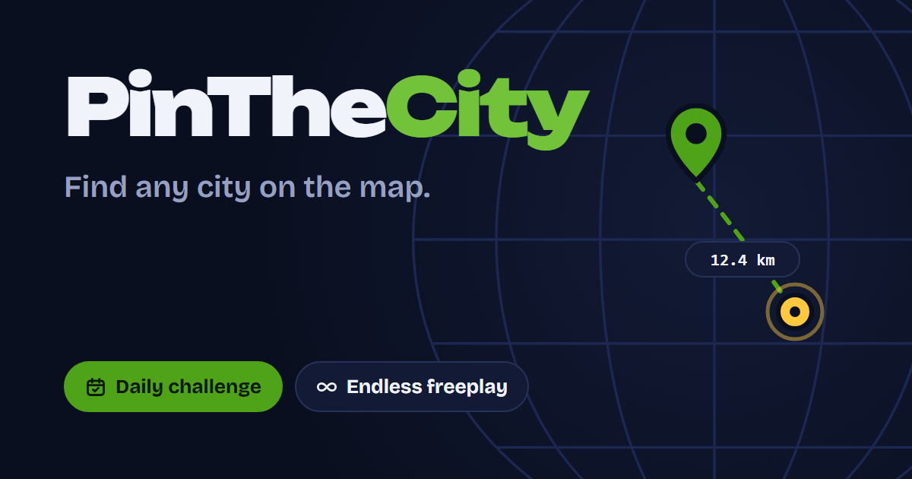

# PinTheCity

**Find any city on the map.** A geography game where you drop a pin where you think a city is, and score points for how close you get.

Play it at **[pinthecity.me](https://pinthecity.me)**.



## How it works

- **Daily challenge:** five cities, the same for everyone, one try per day. Afterwards you see how you did compared to everyone else, and can share your result.
- **Freeplay:** five random cities per game, as many games as you like.
- **Rounds get harder:** each round picks from less familiar places, from the 200 biggest cities in round 1 to small towns in round 5.
- **Same name, many places:** when several places share a name (there are 15 Santa Cruzes), the one nearest to your pin counts.
- **Scoring:** up to 1000 points per round. A pin within 10 km of the city gets the full 1000; after that the score drops smoothly with distance.
- **Accounts are optional:** sign up to keep your best score and settings on every device. Guests can play everything.

## Tech stack

| Part | Built with |
| --- | --- |
| Frontend | React 19, TypeScript, Vite, MapLibre GL with OpenFreeMap tiles |
| API | Rust on Cloudflare Workers (`workers-rs` + axum) |
| Database | Cloudflare D1 (SQLite) |
| Email | Resend (address confirmation and password reset) |
| City data | GeoNames `cities5000`, ranked by fame using Wikidata, converted by a small Rust tool |

## Repository layout

```
api/      Rust Worker: game logic, accounts, daily challenge, D1 migrations
web/      React frontend, served by the same Worker as static assets
import/   Rust tool that turns the GeoNames dump into SQL files for D1
```

## Running it locally

### Prerequisites

- [Node.js](https://nodejs.org/) 24 or newer
- [Rust](https://rustup.rs/) (stable) with the WebAssembly target: `rustup target add wasm32-unknown-unknown`
- Wrangler, the Cloudflare CLI, is run through `npx`; no global install needed

### 1. Build the city data

1. Download [`cities5000.zip`](https://download.geonames.org/export/dump/cities5000.zip) from GeoNames and unzip `cities5000.txt` into `import/data/`. Also download [`countryInfo.txt`](https://download.geonames.org/export/dump/countryInfo.txt) into the same folder; it tells the import which continent each country is on, for the continent games.
2. Fetch how famous each city is (its number of Wikipedia language versions, from Wikidata). It takes a few minutes and writes `import/data/sitelinks.tsv`:

   ```bash
   cd import
   python fetch_fame.py
   ```

   Then fetch what kind of place each one is, also from Wikidata (writes `import/data/types.tsv`), and download the common English words list into `import/data/words/`:

   ```bash
   python fetch_types.py
   curl -L -o data/words/english-10000.txt https://raw.githubusercontent.com/first20hours/google-10000-english/master/google-10000-english-no-swears.txt
   ```

   These keep two kinds of places out of rounds 3–5: parts of a city (districts, neighbourhoods, suburbs, US census-designated places) and English-speaking towns named only with everyday words, like Garden City or Broken Arrow. The 1,000 most famous names are never filtered.

3. Generate the SQL files:

   ```bash
   cargo run --release
   ```

   This writes `names_*.sql`, `cities_*.sql` and `round_names_*.sql` into `import/out/`, plus `round_cities.tsv`, the list of cities that can come up in a round.

   To spell those cities exactly like the map's labels, check them against the OpenFreeMap tiles and then run the import again. It downloads about 17,000 tiles, so it takes a while; if it stops, run it again and it carries on where it left off:

   ```bash
   pip install mapbox-vector-tile
   python fetch_map_names.py
   cargo run --release
   ```

   The second run also writes `renames_*.sql`, which updates the names in an existing database. Rounds pick their cities from `round_names`: the most famous cities come first, and the later rounds are weighted so a few countries don't take over.

4. Only when the borders need updating: `api/data/borders.bin` is committed and compiled into the Worker, which uses it to give a hidden bonus when a pin lands in the right country. To rebuild it, download [`ne_50m_admin_0_countries.geojson`](https://github.com/nvkelso/natural-earth-vector/tree/master/geojson) into `import/data/borders/` and run `python build_borders.py`. Each border piece gets the GeoNames country code that most of the cities inside it use, so codes like French Guiana (`GF`) match the city data.

### 2. Set up the API

Create `api/.dev.vars` (it is git-ignored):

```
DAILY_SECRET=any-long-random-string
APP_URL=http://localhost:5173
```

`DAILY_SECRET` decides which cities each day's challenge uses. Without `RESEND_API_KEY`, emails are printed in the `wrangler dev` terminal instead of being sent, which is handy for testing the email links.

For "Continue with Google", also add `GOOGLE_CLIENT_ID` and `GOOGLE_CLIENT_SECRET` from a Google OAuth web client whose redirect URIs include `http://localhost:5173/api/auth/google/callback`. Without them the button tells players that Google sign-in isn't available.

Create the local database and load the cities:

```bash
cd api
npx wrangler d1 migrations apply DB --local
```

```powershell
Get-ChildItem ..\import\out\names_*.sql, ..\import\out\cities_*.sql, ..\import\out\round_names_*.sql | ForEach-Object { npx wrangler d1 execute DB --local --file $_.FullName }
```

Then start the API on port 8787:

```bash
npx wrangler dev
```

### 3. Start the frontend

```bash
cd web
npm install
npm run dev
```

Open <http://localhost:5173>. Vite forwards every `/api/...` request to the Worker on port 8787.

## Checks

```bash
cd api
cargo test
cargo clippy --target wasm32-unknown-unknown
```

```bash
cd web
npx tsc -b
npm run lint
```

## Deploying

The Worker serves both the API and the built frontend, so a deploy is two steps:

```bash
cd web
npm run build
```

```bash
cd api
npx wrangler deploy
```

One-time setup for a new Cloudflare account:

1. Create the D1 database (`npx wrangler d1 create city-game`) and put its id in `api/wrangler.toml`.
2. Apply the migrations and load the city data with `--remote` instead of `--local`.
3. Set the secrets: `npx wrangler secret put DAILY_SECRET`, `npx wrangler secret put RESEND_API_KEY` and `npx wrangler secret put GOOGLE_CLIENT_SECRET`.
4. Set `APP_URL`, `EMAIL_FROM`, `GOOGLE_CLIENT_ID` and the custom domain in `api/wrangler.toml`.

New migrations go to the live database with `npx wrangler d1 migrations apply DB --remote`.

## API overview

| Method | Path | Purpose |
| --- | --- | --- |
| `POST` | `/api/freeplay` | Start a freeplay game |
| `POST` | `/api/freeplay/guess` | Score a freeplay guess |
| `POST` | `/api/daily` | Start or resume today's challenge |
| `POST` | `/api/daily/guess` | Score a daily guess |
| `GET` | `/api/daily/histogram/{date}` | Everyone's scores for a day |
| `POST` | `/api/register`, `/api/login`, `/api/logout` | Accounts |
| `GET` | `/api/auth/google`, `/api/auth/google/callback` | Continue with Google |
| `GET`, `DELETE` | `/api/me` | Your profile, or delete your account |
| `PATCH` | `/api/me/settings` | Theme and distance units |
| `POST` | `/api/me/verification-email` | Send the confirmation email again |
| `POST` | `/api/verify-email` | Confirm an email address |
| `POST` | `/api/forgot-password`, `/api/reset-password` | Password reset |

Scores are always calculated on the server, so they can't be faked from the browser. Logins, sign-ups and password resets are rate-limited, and a daily job removes expired sessions and old guest data.

## Credits

- Place names and coordinates: [GeoNames](https://www.geonames.org/), [CC BY 4.0](https://creativecommons.org/licenses/by/4.0/) (filtered and grouped by name)
- Map data: © [OpenStreetMap contributors](https://www.openstreetmap.org/copyright), ODbL
- Map tiles and styles: [OpenFreeMap](https://openfreemap.org/), © [OpenMapTiles](https://openmaptiles.org/)
- Fonts: Unbounded, Bricolage Grotesque and JetBrains Mono, SIL Open Font License

The full third-party notices are generated at build time and served at [`/licenses.txt`](https://pinthecity.me/licenses.txt).

## License

© Attila Kámán. All rights reserved.
